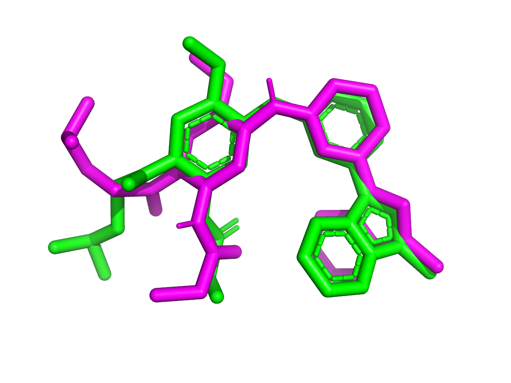

# EGFR 靶点新型抑制剂的 AI 辅助全栈虚拟筛选与动力学验证
# AI-Assisted Full-Stack Virtual Screening & MD Validation Pipeline for EGFR Inhibitors

## 📌 项目概述 / Project Overview
本项目展示了一个端到端（End-to-End）的 AIDD/CADD 研发流水线，用于发现靶向 EGFR 的新型小分子抑制剂。工作流涵盖了**基于结构的虚拟筛选**、**机器学习（QSAR）交叉验证**、**100 纳秒（ns）全原子分子动力学（MD）模拟**、**MM-PBSA 结合自由能计算**、**ADMET 早期毒性评估**以及**分子优先级排序与优化决策**。核心目的是通过物理化学与 AI 的多维交叉验证，剔除传统分子对接的假阳性结果，全面评估候选分子的成药潜力，并为后续湿实验指明方向。
This repository presents an end-to-end AIDD/CADD pipeline for discovering novel EGFR inhibitors. The workflow integrates **structure-based virtual screening**, **machine learning (QSAR) cross-validation**, **100 ns all-atom molecular dynamics (MD) simulations**, **MM-PBSA binding free energy calculations**, **ADMET evaluation**, and **compound prioritization & optimization strategies**. The primary goal is to eliminate false positives, evaluate candidates comprehensively, and guide subsequent wet-lab experiments.

## 🛠️ 技术栈 / Tech Stack
*   **机器学习与化学信息学 (AIDD) / AI & Cheminformatics:** Scikit-learn (随机森林/Random Forest), RDKit, Pandas (Morgan 分子指纹/Fingerprints), ADMET-AI
*   **结构生物学与虚拟筛选 (CADD) / Structure-Based Design:** AutoDock Vina (v1.2.5), Meeko, OpenBabel
*   **分子动力学与热力学 (MD) / Molecular Dynamics:** GROMACS 2018 (GPU 加速/accelerated), acpype (GAFF2 力场/force field), gmx_MMPBSA
*   **自动化与可视化 / Automation & Visualization:** Linux Shell, Python `subprocess`, Matplotlib, PyMOL

## 📂 研发流水线概述 / Pipeline Overview
1.  **靶点结构选择与准备 / Target Structure Selection**：基于 PDB 数据库对 EGFR 激酶域结构进行系统评估。综合考虑**分辨率（9BY4 为 2.31 Å，满足 ≤ 2.5 Å 的优选标准）**、**共晶配体存在（含非共价抑制剂，明确界定 ATP 结合口袋边界）** 及 **野生型状态（无耐药突变）**，最终选用 **PDB: 9BY4** 用于分子对接，保证了格点设置的准确性与初始结构的可靠性。
    Systematically evaluated EGFR structures from the PDB. Considering **resolution (9BY4 at 2.31 Å)**, the presence of a **co-crystal ligand**, and **wild-type status**, **PDB: 9BY4** was selected to ensure accurate grid box setting.
2.  **数据准备 / Data Preparation**：从 ChEMBL 数据库中提取 10,734 个具有 EGFR 活性的化合物。利用 RDKit 进行 Lipinski 类药性五规则过滤，并生成 3D 构象及 PDBQT 格式文件。
    Filtered 10,734 EGFR-active compounds from the ChEMBL database using Lipinski's Rule of Five via RDKit. Generated 3D conformers and PDBQT formats.
3.  **高通量虚拟筛选与 Redocking 验证 (CADD) / High-Throughput Virtual Screening & Validation**：在筛选前，首先进行了 **Redocking 方法学验证**。通过将 9BY4 的共晶配体（Q6K）重新对接至原活性口袋，计算得出最优构象与晶体结构的 **RMSD 为 1.487 Å（< 2.0 Å）**，确保了对接参数（Exhaustiveness=16, 24Å 盒子）的精准性。随后，在 Linux 服务器上编写 Python 自动化脚本，调用 AutoDock Vina 对约 7,500 个化合物完成批量化对接，并根据结合能初筛出 Top 50 候选分子。
    Prior to screening, **Redocking validation** was performed. By re-docking the co-crystal ligand (Q6K) of 9BY4, the **RMSD was calculated to be 1.487 Å (< 2.0 Å threshold)**, ensuring the accuracy of docking parameters. Subsequently, automated the docking of ~7,500 compounds using Python `subprocess` scripts to select the Top 50 candidates.。
    Automated the docking of ~7,500 compounds against the EGFR kinase domain using Python `subprocess` scripts. Selected the Top 50 candidates based on binding affinity.
4.  **AI / QSAR 交叉验证 (AIDD) / AI Cross-Validation**：提取 2048 位 ECFP4 Morgan 分子指纹，训练随机森林回归模型（测试集 R² = 0.682）预测 pIC50。利用该机器学习模型对 Top 50 对接结果进行活性交叉验证，识别假阳性。
    Extracted 2048-bit ECFP4 Morgan fingerprints and trained a Random Forest Regressor (Test R² = 0.682) to predict bioactivity. This ML model was used to cross-validate the Top 50 docking hits.
5.  **MD 体系搭建与模拟 (CADD) / MD Setup & Simulation**：针对 6 个代表性候选分子，利用 GROMACS 开展 100 ns 全原子动力学模拟。编写自动化脚本完成拓扑合并，并使用 GPU 大幅加速计算。
    Conducted 100 ns MD simulations on 6 representative complexes using GROMACS. Developed automated scripts for topology merging and utilized GPU acceleration.
6.  **MM-PBSA 自由能计算 / MM-PBSA Calculation**：基于 100 ns 轨迹提取 100 个代表构象，利用 `gmx_MMPBSA` 计算结合自由能并进行能量拆解。
    Calculated binding free energy using `gmx_MMPBSA` from 100 representative frames extracted from the trajectory, including energy decomposition.
7.  **ADMET 预测 / ADMET Prediction**：利用 ADMET-AI 工具包对候选分子进行 hERG 心脏毒性、Caco-2 渗透性及 CYP450 代谢预测，辅助早期筛选决策。
    Used ADMET-AI to predict hERG toxicity, Caco-2 permeability, and CYP450 metabolism for early-stage filtering.

## 🔬 核心科学发现 / Key Findings
*静态对接和单一机器学习预测均存在局限性。通过结合 AI 模型、MD 模拟与热力学计算，我们揭示了经典的“假阳性”案例并验证了结合驱动力：*
*Static docking and pure ML predictions have limitations. By combining AI, MD, and thermodynamic calculations, we revealed a "false positive" case and validated the driving forces:*
*   Vina 打分最高（-11.57 kcal/mol）的 **CHEMBL5571836** 主构象（pose 1），在 MD 模拟进行到 3 ns 时即从结合口袋中**解离**。然而，次优构象（pose 2）在 100 ns 轨迹中保持了**极高的稳定性**（配体 RMSD 稳定在 0.4 nm 左右）。
    The top-ranked docking pose (Vina score: -11.57 kcal/mol) **dissociated** within 3 ns. However, the secondary pose remained **highly stable** (RMSD ~ 0.4 nm) over 100 ns.
*   **MM-PBSA 热力学验证**：对稳定构象进行结合自由能计算，得到 **ΔG ≈ -37 kcal/mol**。能量拆解表明，**范德华力（-49 kcal/mol）**与**静电力（-44 kcal/mol）**是复合物结合的主要驱动力，与 MD 观察到的疏水包埋和关键氢键网络高度吻合。
    **MM-PBSA Validation:** Binding free energy (ΔG) was calculated to be **~ -37 kcal/mol**. Energy decomposition revealed that **van der Waals (-49 kcal/mol)** and **electrostatic (-44 kcal/mol)** interactions are the main driving forces, consistent with MD observations.

## 📊 结果展示 / Results

*图 1：6 个候选复合物在 100 ns MD 模拟过程中的配体 RMSD 变化曲线。*
*Figure 1: Ligand RMSD over 100 ns MD simulations for 6 candidate complexes.*

*图 2：Redocking 方法学验证。绿色为 9BY4 晶体真实构象，洋红色为 Vina 重对接最优构象（RMSD = 1.487 Å），证明对接参数高度可靠。*
*Figure 2: Redocking validation. Green represents the crystal structure of Q6K, and magenta represents the top-scoring redocked pose (RMSD = 1.487 Å), demonstrating the reliability of the docking parameters.*

### ADMET 早期成药性评估 / Early-stage ADMET Evaluation
我们利用 ADMET-AI 工具包对 Top 50 候选分子进行了评估。**关键结论**：结合能排名前列的候选分子虽然具备极佳的肠道吸收（Caco-2），但其 **hERG 心脏毒性预测值均偏高（> 0.8）**。这提示在后续先导化合物优化中，必须引入多参数优化（MPO）进行结构改造，以降低心脏毒性风险。
We utilized ADMET-AI to evaluate the Top 50 candidates. **Key conclusion**: Despite excellent intestinal absorption (Caco-2), the top-ranked molecules exhibit a **high risk of hERG cardiotoxicity (> 0.8)**. This highlights the necessity of Multi-Parameter Optimization (MPO) in subsequent lead optimization.

详细预测数据见 / Detailed prediction data: [`data/top50_ADMET_evaluated.csv`](data/top50_ADMET_evaluated.csv)

| ChEMBL ID | Affinity (kcal/mol) | hERG (Cardiotoxicity) | Caco2 (Absorption) | CYP3A4 (Metabolism) | Half-Life (hours) |
| :--- | :--- | :--- | :--- | :--- | :--- |
| **CHEMBL5571836** | **-11.57** | 0.90 (High Risk) | -4.45 (Excellent) | 0.88 (Fast) | 15.62 |
| **CHEMBL337026** | **-11.00** | 0.84 (High Risk) | -4.91 (Excellent) | 0.47 (Slow) | 347.91 |
| **CHEMBL338155** | **-10.95** | 0.86 (High Risk) | -5.20 (Excellent) | 0.25 (Slow) | 377.84 |

## 💡 研发决策与结构优化建议 / Lead Optimization & Prioritization Strategy

综合分子对接打分、MD 动力学稳定性、MM-PBSA 热力学结合力与 ADMET 成药性，我们对候选化合物进行了多维度综合评估，并提出以下优先级排序与分子优化方案：
Based on virtual screening, MD stability, MM-PBSA thermodynamics, and ADMET predictions, we comprehensively evaluated the candidates and propose the following prioritization and optimization strategies:

### 1. 化合物综合优先级排序 / Compound Prioritization
*   **Tier 1（高优验证组 / High Priority for Wet-Lab）**：**CHEMBL6001037 (pose 2)**。该分子在 100 ns MD 模拟中表现出极高的构象稳定性（RMSD ~ 0.4 nm），MM-PBSA 结合自由能极强（ΔG ≈ -37 kcal/mol，主要由范德华力驱动），且具备优秀的肠道吸收（Caco-2）。尽管预测存在一定 hERG 风险，但综合成药潜力最高，建议**优先推进体外激酶抑制实验进行验证**。
    **CHEMBL6001037 (pose 2)** is ranked as Tier 1 for wet-lab validation due to its excellent MD stability and strong binding free energy, despite moderate hERG risk.
*   **Tier 2（骨架参考组 / Scaffold Reference）**：**CHEMBL5571836**。虽然其 Vina 对接打分全场最高（-11.57 kcal/mol），但 MD 模拟证实其初始 pose 发生解离（典型假阳性），且 ADMET 预测显示极高的心脏毒性（hERG > 0.9）。建议将其作为**高亲和力骨架**提取药效团，而非直接成药。
    **CHEMBL5571836** is classified as Tier 2 due to its high hERG risk and MD dissociation, serving as a scaffold reference rather than a direct lead.
*   **Tier 3（淘汰/避坑组 / Deprioritized）**：结合力较强但 ADMET 极差（如半衰期过短、代谢过快）的分子，建议直接剔除，以降低后续湿实验的试错成本。

### 2. 分子优化方案 / Molecular Optimization Strategy
针对排名前列的化合物普遍存在的高 hERG 心脏毒性及代谢问题，结合构效关系（SAR）提出以下改造建议：
*   **降低 hERG 毒性（多参数优化 MPO）**：hERG 毒性通常与分子的高脂溶性（LogP）及碱性胺基团相关。建议在保留核心骨架的基础上，采用**生物电子等排（Bioisosterism）**替换，引入亲水性基团（如吗啉、哌嗪或引入极性侧链）以降低 pKa 和脂溶性，从而在维持靶点亲和力的同时降低心脏毒性。
*   **改善代谢稳定性**：针对半衰期较短的分子，可通过封闭易代谢位点（如用氟原子取代易氧化的甲基或芳环），提升其在体内的代谢稳定性。
    To mitigate hERG cardiotoxicity, we suggest introducing hydrophilic groups (e.g., morpholine) or reducing lipophilicity/pKa via bioisosterism. For poor metabolic stability, blocking metabolic hotspots (e.g., fluorination) is recommended.

## 🔭 后续优化方向 / Future Directions
1.  **更精确的自由能计算 (FEP/TI)**：当前采用 MM-PBSA 进行快速热力学评估。对于后续确定的同系物先导化合物系列，将引入 **OpenFE** 或 **BindFlow** 等开源工具进行 FEP/TI 计算，以获得更精确的 ΔΔG。
2.  **生成式分子优化**：以本项目筛选出的高潜力分子为起点，利用 **REINVENT 4** 等强化学习生成模型，结合本项目构建的 **QSAR/ADMET 模型作为多参数奖励函数**，进行骨架装饰与 Linker 设计，实现“生成-评估-优化”的闭环。
3.  **蛋白结构精修**：在具备商业许可的前提下，可引入 **Rosetta** 对目标蛋白进行全原子结构精修与突变体建模，进一步提升初始结构质量。

## 🚀 快速运行指南 / Quick Start
1.  安装依赖环境 / Install dependencies: `pip install -r requirements.txt`
2.  运行数据清洗与配体准备 / Prepare ligands: `python 01_data_prep.py`
3.  运行高通量分子对接 / Run docking: `python 02_batch_docking.py`
4.  训练 QSAR 模型 / Train QSAR model: `python 03_qsar_model.py`
5.  分析 MD 轨迹并出图 / Analyze MD: `python 04_md_analysis.py`
6.  ADMET 预测与 MM-PBSA 说明 / ADMET & MM-PBSA: `python 05_admet_mmpbsa.py`
