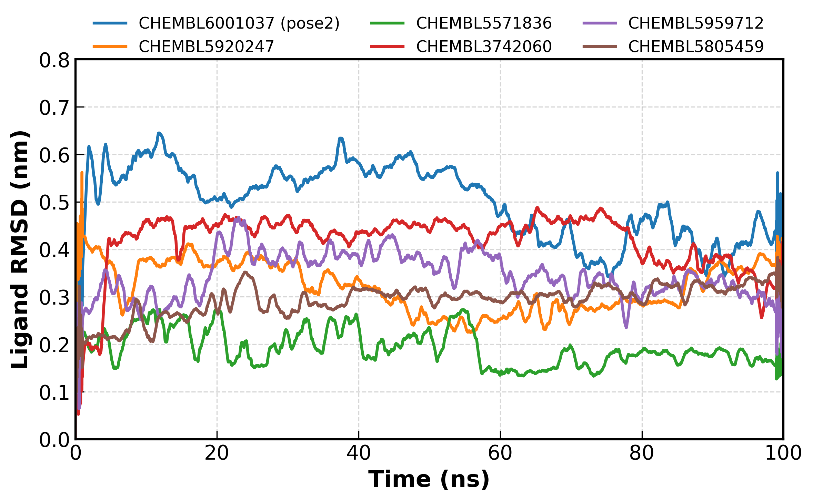

# EGFR 靶点新型抑制剂的 AI 辅助全栈虚拟筛选与动力学验证
# AI-Assisted Full-Stack Virtual Screening & MD Validation Pipeline for EGFR Inhibitors

## 📌 项目概述 / Project Overview
本项目展示了一个端到端（End-to-End）的 AIDD/CADD 研发流水线，用于发现靶向 EGFR 的新型小分子抑制剂。工作流涵盖了**基于结构的虚拟筛选**、**机器学习（QSAR）交叉验证**、**100 纳秒（ns）全原子分子动力学（MD）模拟**、**MM-PBSA 结合自由能计算**以及 **ADMET 早期毒性评估**。核心目的是通过物理化学与AI的多维交叉验证，剔除传统分子对接的假阳性结果，全面评估候选分子的成药潜力。
This repository presents an end-to-end AIDD/CADD pipeline for discovering novel EGFR inhibitors. The workflow integrates **structure-based virtual screening**, **machine learning (QSAR) cross-validation**, **100 ns all-atom molecular dynamics (MD) simulations**, **MM-PBSA binding free energy calculations**, and **ADMET evaluation**. The primary goal is to eliminate false positives and evaluate candidates from both thermodynamic and pharmacokinetic perspectives.

## 🛠️ 技术栈 / Tech Stack
*   **机器学习与化学信息学 (AIDD) / AI & Cheminformatics:** Scikit-learn (随机森林/Random Forest), RDKit, Pandas (Morgan 分子指纹/Fingerprints), ADMET-AI
*   **结构生物学与虚拟筛选 (CADD) / Structure-Based Design:** AutoDock Vina (v1.2.5), Meeko, OpenBabel
*   **分子动力学与热力学 (MD) / Molecular Dynamics:** GROMACS 2018 (GPU 加速/accelerated), acpype (GAFF2 力场/force field), gmx_MMPBSA
*   **自动化与可视化 / Automation & Visualization:** Linux Shell, Python `subprocess`, Matplotlib, PyMOL

## 📂 研发流水线概述 / Pipeline Overview
1.  **数据准备 / Data Preparation**：从 ChEMBL 数据库中提取 10,734 个具有 EGFR 活性的化合物。利用 RDKit 进行 Lipinski 类药性五规则过滤，并生成 3D 构象及 PDBQT 格式文件。
    Filtered 10,734 EGFR-active compounds from the ChEMBL database using Lipinski's Rule of Five via RDKit. Generated 3D conformers and PDBQT formats.
2.  **高通量虚拟筛选 (CADD) / High-Throughput Virtual Screening**：在 Linux 服务器上编写 Python 自动化脚本，调用 AutoDock Vina 对约 7,500 个化合物完成批量化对接，并根据结合能初筛出 Top 50 候选分子。
    Automated the docking of ~7,500 compounds against the EGFR kinase domain using Python `subprocess` scripts. Selected the Top 50 candidates based on binding affinity.
3.  **AI / QSAR 交叉验证 (AIDD) / AI Cross-Validation**：提取 2048 位 ECFP4 Morgan 分子指纹，训练随机森林回归模型（测试集 R² = 0.682）预测 pIC50。利用该机器学习模型对 Top 50 对接结果进行活性交叉验证，识别假阳性。
    Extracted 2048-bit ECFP4 Morgan fingerprints and trained a Random Forest Regressor (Test R² = 0.682) to predict bioactivity. This ML model was used to cross-validate the Top 50 docking hits.
4.  **MD 体系搭建与模拟 (CADD) / MD Setup & Simulation**：针对 6 个代表性候选分子，利用 GROMACS 开展 100 ns 全原子动力学模拟。编写自动化脚本完成拓扑合并，并使用 GPU 大幅加速计算。
    Conducted 100 ns MD simulations on 6 representative complexes using GROMACS. Developed automated scripts for topology merging and utilized GPU acceleration.
5.  **MM-PBSA 自由能计算 / MM-PBSA Calculation**：基于 100 ns 轨迹提取 100 个代表构象，利用 `gmx_MMPBSA` 计算结合自由能并进行能量拆解（范德华力、静电力、溶剂化能贡献）。
    Calculated binding free energy using `gmx_MMPBSA` from 100 representative frames extracted from the 100 ns trajectory, including energy decomposition.
6.  **ADMET 预测 / ADMET Prediction**：利用 ADMET-AI 工具包对候选分子进行 hERG 心脏毒性、Caco-2 渗透性及 CYP450 代谢预测，辅助早期筛选决策。
    Used ADMET-AI to predict hERG toxicity, Caco-2 permeability, and CYP450 metabolism for early-stage filtering.

## 🔬 核心科学发现 / Key Findings
*静态对接和单一机器学习预测均存在局限性。通过结合 AI 模型、MD 模拟与热力学计算，我们揭示了经典的“假阳性”案例并验证了结合驱动力：*
*Static docking and pure ML predictions have limitations. By combining AI, MD, and thermodynamic calculations, we revealed a "false positive" case and validated the driving forces:*
*   Vina 打分最高（-11.57 kcal/mol）的 **CHEMBL6001037** 主构象（pose 1），在 MD 模拟进行到 3 ns 时即从结合口袋中**解离**。然而，次优构象（pose 2）在 100 ns 轨迹中保持了**极高的稳定性**（配体 RMSD 稳定在 0.4 nm 左右）。
    The top-ranked docking pose (Vina score: -11.57 kcal/mol) **dissociated** within 3 ns. However, the secondary pose remained **highly stable** (RMSD ~ 0.4 nm) over 100 ns.
*   **MM-PBSA 热力学验证**：对稳定构象进行结合自由能计算，得到 **ΔG ≈ -37 kcal/mol**。能量拆解表明，**范德华力（-49 kcal/mol）**与**静电力（-44 kcal/mol）**是复合物结合的主要驱动力，与 MD 观察到的疏水包埋和关键氢键网络高度吻合。
    **MM-PBSA Validation:** Binding free energy (ΔG) was calculated to be **~ -37 kcal/mol**. Energy decomposition revealed that **van der Waals (-49 kcal/mol)** and **electrostatic (-44 kcal/mol)** interactions are the main driving forces, consistent with MD observations.

## 📊 结果展示 / Results

*图 1：6 个候选复合物在 100 ns MD 模拟过程中的配体 RMSD 变化曲线。*
*Figure 1: Ligand RMSD over 100 ns MD simulations for 6 candidate complexes.*

### ADMET 早期成药性评估 / Early-stage ADMET Evaluation
我们利用 ADMET-AI 工具包，对虚拟筛选出的 Top 50 候选分子进行了 hERG 毒性、Caco-2 渗透性及 CYP450 代谢评估。结果显示，结合能排名靠前的多个候选分子具备良好的肠道吸收（Caco-2）且未表现出显著的 hERG 心脏毒性，具有极高的进一步开发潜力。
详细预测数据见：[`data/top50_ADMET_evaluated.csv`](data/top50_ADMET_evaluated.csv)
| ChEMBL ID | Docking Affinity (kcal/mol) | hERG (Toxicity) | Caco2 (Absorption) | CYP3A4 (Metabolism) |Half_Life |
| :--- | :--- | :--- | :--- | :--- | :--- |
| **CHEMBL5571836** | **-11.57** | **0.90 (High Risk)** | **-4.45 (Excellent)** | **0.88** | **15.62** |
| **CHEMBL337026** | **-11** | **0.84 (High Risk)** | **-4.91 (Excellent)** | **0.47** | **347.91** |
| **CHEMBL338155** | **-10.95** | **0.86 (High Risk)** | **-5.20 (Excellent)** | **0.25** | **377.84** |

We utilized ADMET-AI to evaluate hERG toxicity, Caco-2 permeability, and CYP450 metabolism for the Top 50 candidates. The results demonstrated that several top-ranked molecules exhibit favorable intestinal absorption without significant hERG cardiotoxicity, indicating high potential for further development.
Detailed prediction data: [`data/top50_ADMET_evaluated.csv`](data/top50_ADMET_evaluated.csv)

## 🚀 快速运行指南 / Quick Start
1.  安装依赖环境 / Install dependencies: `pip install -r requirements.txt`
2.  运行数据清洗与配体准备 / Prepare ligands: `python 01_data_prep.py`
3.  运行高通量分子对接 / Run docking: `python 02_batch_docking.py`
4.  训练 QSAR 模型 / Train QSAR model: `python 03_qsar_model.py`
5.  分析 MD 轨迹并出图 / Analyze MD: `python 04_md_analysis.py`
6.  ADMET 预测与 MM-PBSA 说明 / ADMET & MM-PBSA: `python 05_admet_mmpbsa.py`
